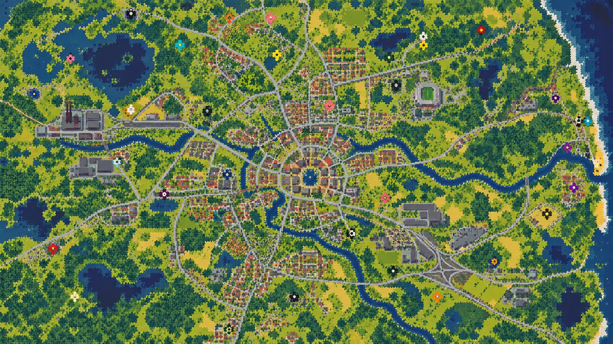

# Green-Eye // Gliwice Cleanup

## Gameplay video

<video controls width="720" preload="metadata">
  <source src="assets/user/media/gameplay-video.mp4" type="video/mp4">
  Your browser does not support embedded video. [Open the gameplay video directly](assets/user/media/gameplay-video.mp4).
</video>

[▶ Watch the gameplay recording](assets/user/media/gameplay-video.mp4)



Green-Eye is a small 3D arcade action game set in a stylised version of Gliwice. The player is a cheerful city cleaner who travels through local streets, leaves the car, fights hostile skeletons and zombies with colourful cleanup weapons, earns coins and upgrades, and eventually reaches the ZSTI school boss arena.

The project combines Ursina/Panda3D 3D models with a readable arcade HUD. It has a complete playable loop: intro animation, menu, three connected stages, driving, walking, shooting, enemy projectiles, target lock, shop, inventory, upgrades, minimap, boss fight and save data.

## Features

- Three locations: residential **ul. Zwycięstwa**, darker **ul. Dworcowa**, and the final **ZSTI School** arena.
- Skippable opening animation showing the undead invasion of the city.
- 3D city, road, car, character, nature and enemy assets loaded from local asset packs.
- Enter and leave the car; the player model is hidden while driving.
- Car acceleration, braking, steering, building collision and traffic collision.
- Impact physics: when the player's car hits another car, the other car receives an impulse, slides away, rotates and slows down.
- On-foot cleanup combat with mouse aiming, target lock, homing assistance near enemies and projectile effects.
- Slow enemy projectiles that can be dodged.
- Cleanup Pan, Rolling Pin and Soup Blaster weapons.
- Shop, numbered hotbar inventory, coins, XP and end-of-level upgrade cards.
- Health bar, minimap, contextual prompts and boss health bar.
- Progress saved to `save.json`.
- Secret Konami Code: `↑ ↑ ↓ ↓ ← → ← → B A` activates RGB character colours and `1000 / 1000 HP`.

## Requirements

- Python 3.10 or newer
- Packages from `requirements.txt`
- Desktop with an OpenGL-capable graphics driver

## Run on Linux

```bash
cd /home/zawe/Green-Eye
python3 -m venv .venv
.venv/bin/python -m pip install -r requirements.txt
.venv/bin/python main.py
```

The system Python may reject global pip installs with the PEP 668 “externally managed environment” message. The virtual-environment commands above avoid that problem.

## Controls

| Input | Action |
|---|---|
| `WASD` | Walk on foot |
| `Shift` | Run |
| `S` / `W` | Drive forward / reverse |
| `A` / `D` | Steer |
| `E` | Enter/leave car, use shop or quest board, continue east |
| Mouse / `J` | Aim and fire |
| `Tab` | Lock onto the nearest enemy |
| `1`–`3` | Select a weapon or upgrade card |
| `P` | Buy a pan damage upgrade in the shop |
| `Esc` | Pause/menu |
| `Enter` | Continue or restart |

### Secret code

Enter `Up, Up, Down, Down, Left, Right, Left, Right, B, A` at any time. The player receives 1000 maximum/current HP and the character cycles through RGB colours.

## Game flow

1. Skip or watch the intro animation.
2. Start at the car on ul. Zwycięstwa.
3. Leave the car, clear enemies, and use the shop or job board.
4. Return to the car and drive east to unlock the next street.
5. Choose one of three upgrade cards after clearing a stage.
6. Reach ZSTI and defeat the Principal of Disorder and the guards.

Traffic vehicles are physical objects. A fast impact pushes the other car away, while walls and buildings stop the player vehicle.

## Project structure

```text
main.py       application entry point
game3d.py     3D game loop, states, city, driving and combat
assets.py     legacy asset-loading helpers
settings.py   shared settings/constants
sound.py      sound helpers
overworld.py  legacy 2D overworld slice
fight.py      legacy 2D fight slice
quests.py     quest data
sprites.py    legacy sprite helpers
assets/user/  user-provided assets, highest priority
assets/found/ free/found assets
assets/generated/ procedural fallbacks
```

The current executable entry point is `main.py`, which starts `game3d.py`. The older 2D modules remain as the original prototype architecture and are not imported by the current 3D entry point.

## Assets and licensing

User-provided assets are kept under `assets/user/` and are never overwritten by the game. The city, car, road, character, nature and KayKit skeleton packs are used as local 3D content. See [CREDITS.md](CREDITS.md) for source and license information.


The Gliwice map is used as the menu/map reference. Missing or incompatible nature tree materials are avoided by using textured City Kit tree models for visible trees.

## Project media

The repository also includes a small meme-cat image and a compressed gameplay recording:


- [Gameplay recording (MP4)](assets/user/media/gameplay-video.mp4)
- [Meme cat image (JPG)](assets/user/media/meme-cat.jpg)

The original phone recording is kept outside the repository because it is 533 MB, above GitHub's 100 MB regular-file limit. `gameplay-video.mp4` is a GitHub-compatible 480p copy; the original file was not modified.

## Saving and troubleshooting

- Delete `save.json` only if you intentionally want to reset coins, XP and unlocked weapons.
- If a window opens white or does not appear, run from the virtual environment and check the terminal for the first actual traceback.
- `AL lib`/PulseAudio warnings are safe when the system has no audio device; Ursina falls back to a null audio manager.

## Latest update

The latest build includes stronger traffic collision physics. The player car is allowed to make contact with traffic instead of being blocked by an invisible radius; the struck car receives a visible knockback impulse and friction-based slowdown. The build was syntax-checked and launched through a virtual display before being pushed to `main`.
